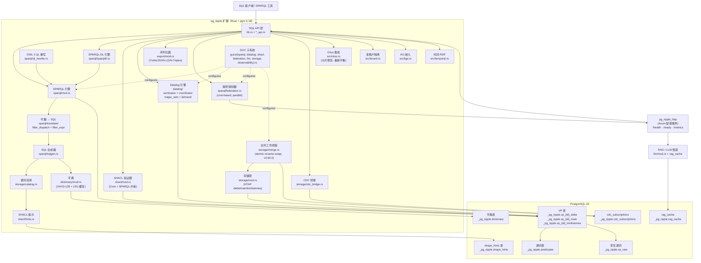

# 架构

此页面描述了截至 v0.60.0 的 pg_ripple 的内部架构。

## 概述

pg_ripple 是一个 PostgreSQL 18 扩展，用 Rust（pgrx 0.18）编写，实现了具有原生 SPARQL 查询执行的高性能 RDF 三元组存储。所有用户可见的函数位于 `pg_ripple` schema 中；内部表和 VP（垂直分区）表位于 `_pg_ripple` schema 中。

## 组件映射



## 源代码树结构

| 路径 | 责任 |
|------|---------------|
| `src/lib.rs` | pgrx 入口点，GUC 注册，`_PG_init`，钩子 |
| `src/gucs.rs` | 所有 GUC `static` 声明 |
| `src/schema.rs` | `extension_sql!()` DDL 块 |
| `src/dictionary/` | IRI / 空白节点 / 字面值 → `i64` 编码器（XXH3-128 + LRU） |
| `src/storage/` | VP 表 I/O，HTAP delta/main 分区，合并工作线程 |
| `src/storage/catalog.rs` | 谓词 → VP 表 OID 缓存（SPI 调用减少） |
| `src/sparql/` | SPARQL 文本 → 代数 → SQL → SPI → 解码 |
| `src/sparql/translate/` | 按代数节点的翻译存根（BGP、Join、Filter、…） |
| `src/sparql/plan_cache.rs` | 按后端的计划缓存，按代数摘要（XXH3-128）键控 |
| `src/datalog/` | Datalog 规则解析器、分层器、SQL 编译器 |
| `src/shacl/` | SHACL 形状 → 验证管道 |
| `src/shacl/constraints/` | 按约束类型的验证（count、string、logical、…） |
| `src/shacl/hints.rs` | SHACL → SQL 生成提示（连接类型、DISTINCT） |
| `src/export/` | Turtle / N-Triples / JSON-LD 序列化 |
| `src/federation_registry.rs` | SPARQL 联邦端点注册表 |
| `src/stats_admin.rs` | 监控，pg_stat_statements 集成 |
| `src/graphrag_admin.rs` | 向量嵌入，混合搜索，GraphRAG 管道 |
| `src/*_api.rs` | SQL 暴露的 pg_extern 包装器 |

## 存储模型

每个 IRI、空白节点和字面值都通过字典编码步骤（XXH3-128 哈希）映射到 `BIGINT`（i64）。VP 表**从不**包含原始字符串 — 所有连接都是整数连接。

```
          原始 IRI/字面值
               │
      dictionary.encode()
               │
           i64 哈希
               │
     存储在 VP 表中（s、o、g、i、source）
```

对于每个唯一谓词，有一个 VP 表：`_pg_ripple.vp_{predicate_id}`。少于 `vp_promotion_threshold`（默认值：1,000）个三元组的谓词存储在合并的 `_pg_ripple.vp_rare` 表中。

## 查询执行管道

```
SPARQL 文本
    │
    ▼ spargebra::Query::parse()
SPARQL 代数
    │
    ▼ sparopt 优化器（BGP 重排序，连接顺序）
优化后的代数
    │
    ▼ SPARQL→SQL 翻译器（sqlgen.rs + translate/）
SQL 文本
    │
    ▼ PostgreSQL SPI 执行器
原始行
    │
    ▼ dictionary.decode()
JSONB 结果集
```

## 计划缓存

按后端计划缓存（v0.13.0）将**代数摘要**映射到生成的 SQL。摘要计算如下：

```
digest = XXH3-128( spargebra::Query::display(query) )
key    = "{digest}\x00max_depth={n}\x00bgp_reorder={b}"
```

使用代数显示形式（而不是原始查询文本）意味着同一查询的空白和前缀别名变体共享一个缓存槽。

## SHACL 提示集成

使用 `pg_ripple.load_shacl()` 加载形状后，谓词级提示被写入 `_pg_ripple.shape_hints`。SQL 生成器通过谓词目录读取这些提示以：

- 当为谓词设置 `sh:maxCount 1` 时，省略 `DISTINCT`。
- 当设置 `sh:minCount 1` 时，使用 `INNER JOIN` 而不是 `LEFT JOIN`。

提示在形状被删除时自动失效（`pg_ripple.invalidate_catalog_cache()`）。