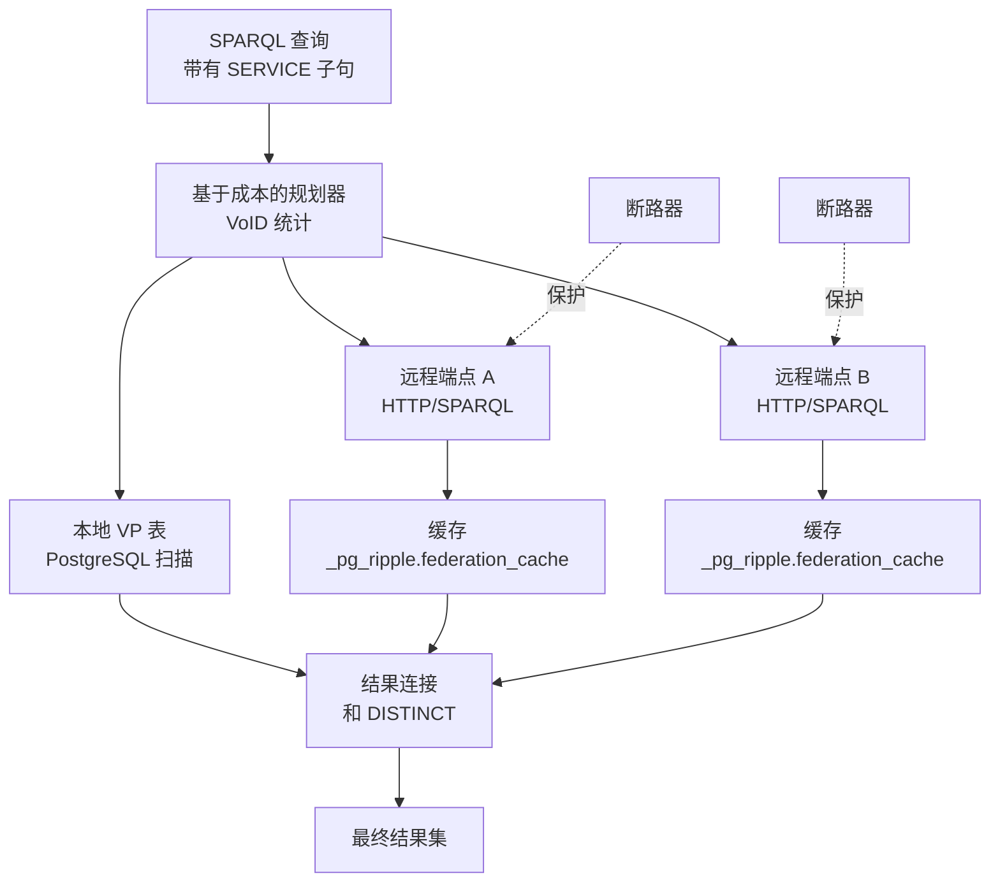

# 联邦参考

此页面是 pg_ripple 的 SPARQL 1.1 联邦引擎的参考。

## 概述

pg_ripple 使用基于成本的规划器、结果缓存、连接池、断路器保护和平行远程执行实现 SPARQL 1.1 联邦查询（SERVICE 关键字）。本地图可以映射到 `SERVICE` 端点，以便规划器透明地将看起来远程的查询重写为本地扫描。



## 状态

```sql
SELECT feature_name, status FROM pg_ripple.feature_status()
WHERE feature_name LIKE '%federation%' OR feature_name = 'sparql_federation';
```

## SQL 函数

| 函数 | 描述 |
|---|---|
| `pg_ripple.register_endpoint(url TEXT, name TEXT, complexity TEXT) → void` | 注册远程 SPARQL 端点 |
| `pg_ripple.drop_endpoint(name TEXT) → void` | 删除端点注册 |
| `pg_ripple.list_endpoints() → SETOF record` | 列出所有已注册的端点 |
| `pg_ripple.is_endpoint_healthy(url TEXT) → BOOLEAN` | 检查断路器健康状态 |
| `pg_ripple.federation_stats() → SETOF record` | 每个端点的查询延迟和错误统计 |

## SERVICE 子句

在查询中使用标准 SPARQL `SERVICE` 子句：

```sparql
SELECT ?s ?label WHERE {
  ?s a <http://example.org/Person> .
  SERVICE <https://dbpedia.org/sparql> {
    ?s rdfs:label ?label .
    FILTER(LANG(?label) = "en")
  }
}
```

## 基于成本的规划

联邦规划器使用 VoID 统计信息（存储在 `_pg_ripple.endpoint_stats` 中）来估计远程结果大小并对 SERVICE 子查询进行排序，以最小化总网络往返次数。`complexity` 字段（`fast`/`normal`/`slow`）调整排序。

## 缓存

来自远程端点的结果缓存在 `_pg_ripple.federation_cache` 中，以 `(endpoint_id, query_hash)` 为键。缓存 TTL 由 `pg_ripple.federation_cache_ttl`（默认值：60 秒）控制。

## 断路器

每个端点在 `_pg_ripple.federation_health` 中跟踪探测历史。当端点在探测窗口内失败的次数超过 `pg_ripple.federation_circuit_threshold` 时，它被标记为不健康，并且未来的 SERVICE 调用立即返回空结果，直到成功的探测。

## 分片修剪（Citus）

当安装了 Citus 时，解析为本地分片的 SERVICE 子句被重写为直接分片扫描，从而消除协调器开销。对于链接的 `SERVICE` 模式支持多跳修剪。

## 相关页面

- [联邦 SQL 参考](../user-guide/sql-reference/federation.md)
- [HTTP API 参考](http-api.md)
- [可扩展性](scalability.md)
- [Citus SERVICE 分片修剪](citus-service-pruning.md)
- [功能状态分类](feature-status-taxonomy.md)